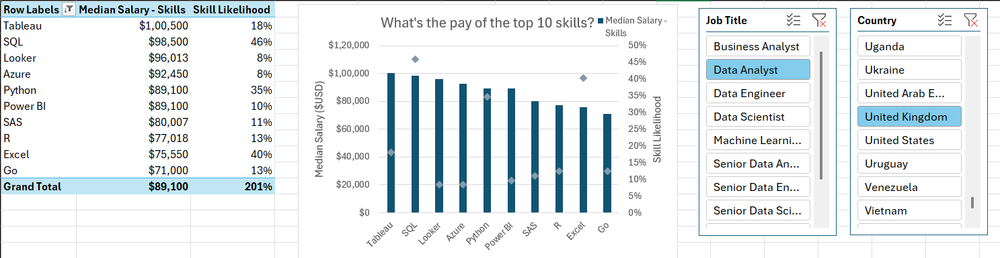

# 📊 Data Job Market Analysis in Excel

An Excel-only analysis of data job postings: how skills, location, and job title relate to pay.


---

## 📌 Overview

As a former job seeker, I was surprised by how little data there was on which roles and skills pay best in the data market. This project uses Excel's built-in analytics stack to answer four questions about 2023 data job postings.

### Questions

1. Do more skills get you better pay?
2. What is the salary for data jobs in the US vs. outside the US?
3. What are the most requested skills?
4. What do the top skills pay?

### Tools

| Tool | Used for |
| --- | --- |
| Power Query | Extract, clean, and load the raw job and skill data (ETL) |
| Power Pivot | Data model linking jobs to skills on `job_id` |
| DAX | Median salary measures, including a US-only measure |
| PivotTables / PivotCharts | Aggregation and visualization |

---

## 📁 Repository Structure

```
.
├── README.md
├── salary_analysis.xlsx      # Final workbook (4 analysis sheets, 3 charts)
└── assets/
    └── images/               # Screenshots and chart exports used below
```

### Workbook sheets

| Sheet | Contents |
| --- | --- |
| `Skill_Job_Analysis` | Skill likelihood across postings, with chart |
| `Salary_Vs_Skills` | Median salary vs. average skills per job, by title, with chart |
| `Salary_Analysis` | Median salary by title: overall, US, and non-US |
| `Skill_Salary_Analysis` | Median salary per skill alongside skill likelihood, with combo chart |

---

## 🔧 Methodology

### 1. ETL with Power Query

- **Extract:** Loaded the source workbook and created two queries: one for job details (`data_jobs_all`) and one listing skills per job (`data_job_skills`).
- **Transform:** Set column types, dropped unneeded columns, cleaned text, and trimmed whitespace.
- **Load:** Loaded both queries into the workbook as the base for the data model.

### 2. Data model with Power Pivot

Related `data_jobs_all` and `data_job_skills` on the `job_id` column so PivotTables can slice salary by skill.

### 3. Measures with DAX

```dax
Median Salary := MEDIAN(data_jobs_all[salary_year_avg])
```

```dax
Median Salary US :=
CALCULATE(
    MEDIAN(data_jobs_all[salary_year_avg]),
    data_jobs_all[job_country] = "United States"
)
```

### 4. Visualization

PivotCharts for each question, including a combo chart (clustered columns for median salary, markers for skill likelihood on a secondary axis).

---

## 📈 Findings

> **Note:** The summary tables in this workbook are built from a small sample of postings, so treat these as directional observations rather than market-wide conclusions.

### 1️⃣ Do more skills get you better pay?

Not in a straight line. The highest median salaries belong to Cloud Engineer ($197.5K, ~3 skills per job) and Software Engineer ($187.3K, ~3.5 skills). Among data-focused titles, Senior Data Engineer pairs the most skills (~10.3 per job) with the highest pay ($147.5K). Business Analyst (~6 skills) and Data Scientist (~5.3 skills) sit near the bottom at about $71K.

| Job title | Median salary | Avg. skills per job |
| --- | ---: | ---: |
| Cloud Engineer | $197,500 | 3.0 |
| Software Engineer | $187,250 | 3.5 |
| Senior Data Engineer | $147,500 | 10.3 |
| Data Engineer | $96,773 | 8.8 |
| Data Analyst | $92,772 | 3.0 |
| Machine Learning Engineer | $85,515 | 8.0 |
| Business Analyst | $71,100 | 6.0 |
| Data Scientist | $71,000 | 5.3 |

**Takeaway:** Role and seniority appear to matter more than raw skill count.


### 2️⃣ Salary by region

| Job title | Median (US) | Median (non-US) |
| --- | ---: | ---: |
| Machine Learning Engineer | $150,000 | $101,029 |
| Senior Data Engineer | $150,000 | $147,500 |
| Data Scientist | $130,000 | $119,550 |
| Data Engineer | $125,000 | $123,500 |
| Software Engineer | $125,000 | $89,100 |
| Cloud Engineer | $115,000 | $89,100 |
| Business Analyst | $90,000 | $75,000 |
| Data Analyst | $90,000 | $90,000 |
| **All roles** | **$118,940** | **$111,175** |

**Takeaway:** US medians are higher for most roles, with the largest gap for Machine Learning Engineer (about $49K). Data Analyst pay is identical in both groups, and Data Engineer is nearly level.


### 3️⃣ Most requested skills

Python and SQL each appear in **75%** of postings. Every other skill (Power BI, Excel, Tableau, Flow, JavaScript, SQL Server) appears in **25%**.

**Takeaway:** Python and SQL are the clear baseline for data roles in this dataset.

### 4️⃣ Pay for the top skills

| Skill | Median salary | Skill likelihood |
| --- | ---: | ---: |
| Flow | $111,202 | 25% |
| Python | $111,175 | 75% |
| SQL | $111,175 | 75% |
| Tableau | $45,000 | 25% |
| SQL Server | $45,000 | 25% |
| JavaScript | $45,000 | 25% |
| Excel | $45,000 | 25% |
| Power BI | $45,000 | 25% |

**Takeaway:** Python and SQL combine high demand with high pay. Because several skills share the same $45K median, the sample is likely drawing on very few postings for those skills, so this comparison is the weakest in the workbook.



---

## ✅ Conclusion

- Python and SQL are the most requested skills and are associated with the strongest median pay.
- Job title and seniority track salary more closely than the number of skills listed.
- US salaries run higher than non-US for most roles, but the gap varies widely by title.

**Next steps:** run the same model on the full dataset, add a skills-by-role breakdown, and extend the regional view beyond US vs. non-US.

---

## 🚀 How to Use

1. Download `salary_analysis.xlsx`.
2. Open in desktop Excel (Windows) to use the Power Pivot data model and Power Query connections.
3. Refresh the PivotTables from **Data → Refresh All** after pointing Power Query at your copy of the source data.

## 📚 Data Source

2023 data job postings (job titles, salaries, locations, skills). 

